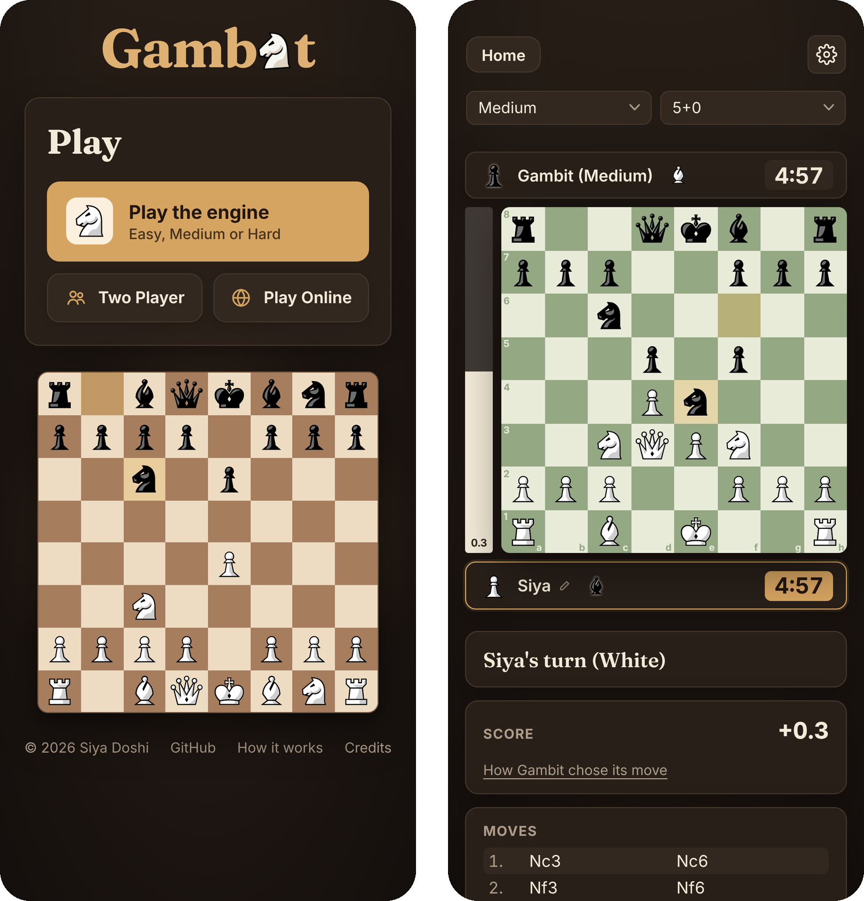

<div align="center">


# Gambit

A chess engine built from scratch that plays at 1,900+ Elo, right in your browser.

**[Play it live](https://chess-engine-1smz.onrender.com/)** &nbsp;·&nbsp; [How it thinks](#how-it-thinks) &nbsp;·&nbsp; [How strong it is](#how-strong-it-is)

</div>

<br />


Gambit looks several moves ahead, skips the lines that can't matter, and remembers positions it has already worked out. There's no server doing the thinking: every move is searched on your own device.

## Highlights

- **Built from scratch.** The search, the way it scores positions and every speed-up are my own code, and each speed-up is measured on its own.
- **99% less searching.** To pick a move, Gambit examines about 1% of the positions a brute-force search would, and still finds the same move.
- **A measured rating.** Elo is the rating system chess uses to compare players. Gambit's comes from 96 games per level against Stockfish, the strongest open-source engine, with a 95% confidence range.
- **Online play that holds up.** A refresh, a dropped connection or even a server restart puts both players back in the same game.

## Ways to play

| Against the engine | Two players | Online |
| --- | --- | --- |
| Easy, Medium or Hard, with a bar showing who is ahead, hints, and the numbers behind each move | One screen, passed back and forth | Share a link or a room code. The server checks every move and runs the clocks, so neither side can cheat |

Every mode has drag or tap to move, chess clocks from 1 to 10 minutes (with or without time added after each move), a move list you can step back through, board and piece themes, and games that survive a refresh.

<p align="center">
  
</p>

## How it thinks

To choose a move, Gambit plays out the future in its head: every move it could make, every reply you could make, every answer to that, and so on. How many moves ahead it looks is called the **depth**. At the end of each line it scores the position, counting material in pawns and adding a little for pieces on good squares, and it assumes both sides always pick their best option. This approach is called **minimax**.

The catch is size. A chess position has about 30 legal moves, so looking just 4 moves ahead means close to a million positions. Most of Gambit's design is about finding the same best move while examining far fewer:

| Technique | What it does |
| --- | --- |
| **Alpha-beta pruning** | Stops examining a move once it's clear the opponent has a reply that makes it worse than a move already found. Whole branches are skipped without changing the result. |
| **Move ordering** | Pruning skips the most when the best moves are examined first, so Gambit looks at captures and the previous best move before anything else. |
| **Transposition table** | Different move orders often reach the same position. Gambit stores every result it works out, so a repeated position is looked up instead of searched again. |
| **Quiescence search** | A search that stops halfway through an exchange gets fooled, for example by taking a pawn without seeing the recapture. So at the end of each line, Gambit keeps playing out captures until the position is calm. |
| **Draw awareness** | Gambit knows the draw rules (a position repeated three times, or 50 moves without a capture or pawn move), so it steers away from a draw when ahead and toward one when behind. |
| **Iterative deepening** | Gambit searches 1 move deep, then 2, then 3, until its time runs out, and plays the best move from the deepest search it finished. |

The search runs on a background thread (a Web Worker), so the page stays responsive while Gambit thinks.

<details>
<summary><b>More detail on each technique</b></summary>
<br />

**Alpha-beta pruning.** Gambit is written as NegaMax, a form of minimax that uses one function for both sides, because a position that is +2 for White is −2 for Black. During the search it tracks two bounds: the score Gambit can already guarantee (alpha) and the score the opponent can already guarantee (beta). Any branch that falls outside them can't change the final choice, so it is cut off.

**Move ordering.** Captures are sorted so that cheap pieces taking valuable ones come first (a pawn taking a queen before a queen taking a pawn). The best move from the previous, shallower search goes ahead of everything.

**Transposition table.** Each position gets a 64-bit fingerprint (a Zobrist hash) built from its pieces and squares, so a lookup is instant. Each entry keeps the score, how deep it was searched and the best move found. At depth 5 this alone halves the positions searched.

**Quiescence search.** Without it, Gambit would grab a defended pawn with its queen, because the recapture sits just past the end of its search. Following captures to the end avoids this "horizon effect".

**Draw awareness.** Whether a position is a draw depends on how it was reached, not just what is on the board, so these scores are kept out of the transposition table.

**Iterative deepening.** Each pass also tells the next one which moves to try first, so searching 1, 2, 3 and then 4 moves deep costs little more than searching 4 directly.

</details>

<details>
<summary><b>Where the code lives</b></summary>
<br />

| File | Role |
| --- | --- |
| [`search.js`](web/public/js/engine/search.js) | The search and everything that speeds it up |
| [`evaluate.js`](web/public/js/engine/evaluate.js) | Scores a position: material, plus a bonus or penalty for each piece's square |
| [`board.js`](web/public/js/engine/board.js) | Lists the legal moves in a position, at about 575,000 positions per second |
| [`levels.js`](web/public/js/engine/levels.js) | Easy, Medium and Hard |
| [`worker.js`](web/public/js/engine/worker.js), [`client.js`](web/public/js/engine/client.js) | Runs the search off the main thread |

</details>

### Searching less

Plain minimax examines every line to the given depth. Gambit adds alpha-beta pruning, move ordering and the transposition table, and finds the same move:

| Position | Plain minimax | Gambit | Saved |
| --- | --- | --- | --- |
| Start position, depth 4 | 216,369 | 2,004 | **99.1%** |
| Italian Game, depth 4 | 978,800 | 9,706 | **99.0%** |
| Kiwipete, depth 3 | 102,087 | 2,641 | **97.4%** |

The Italian Game is a common opening. Kiwipete is a crowded middlegame position that chess programmers use as a stress test.

<details>
<summary><b>Each technique's share</b></summary>
<br />

`npm run bench` adds the techniques one at a time. Quiescence search is off, so every column searches the same tree.

| Position | Minimax | + Alpha-beta | + Move ordering | + Transposition table |
| --- | --- | --- | --- | --- |
| Start position (depth 4) | 216,369 · 5.1s | 2,152 · 0.06s | 2,128 · 0.05s | 2,004 · 0.04s |
| Italian Game (depth 4) | 978,800 · 30.9s | 92,739 · 2.8s | 13,087 · 0.42s | 9,706 · 0.30s |
| Kiwipete (depth 3) | 102,087 · 4.1s | 5,164 · 0.21s | 2,847 · 0.12s | 2,641 · 0.11s |

</details>

## How strong it is

| Level | How it plays | Elo | 95% range |
| --- | --- | --- | --- |
| Easy | Looks 3 moves ahead, and sometimes picks its second or third choice | **1,543** | 1,468–1,628 |
| Medium | Looks 4 moves ahead | **1,780** | 1,706–1,859 |
| Hard | Looks as far as it can in 2.5 seconds, usually 5–6 moves | **1,939** | 1,865–2,016 |

Each level played 96 games against Stockfish 16.1, set to play at fixed ratings. Gambit's rating is the one that best explains its results. With 96 games, the true rating is very likely within the 95% range. These ratings are on Stockfish's scale, which is not the same as chess.com's or the official FIDE ratings, so they measure strength rather than compare directly with a player's rating.

<details>
<summary><b>How the games were played</b></summary>
<br />

Every level faced two Stockfish ratings, starting from 24 different openings and playing each opening once with each color, so neither side benefits from a lucky start. Each game used 60 seconds per side plus 0.6 seconds per move, the time control Stockfish's ratings are calibrated for. The games ran in parallel on GitHub Actions. On Easy, Gambit's deliberate weaker moves never give away a piece.

| Level | Wins / draws / losses |
| --- | --- |
| Easy | 64 / 1 / 31 |
| Medium | 56 / 4 / 36 |
| Hard | 51 / 4 / 41 |

</details>

## Try it locally

To run Gambit on your own computer:

```bash
cd web
npm install
npm start      # opens on http://localhost:3000
npm test       # engine and server tests
```

Or open the repo in GitHub Codespaces, which sets everything up for you.

<details>
<summary><b>What the tests cover</b></summary>
<br />

- **Engine:** finds forced mates, wins free material, avoids walking into recaptures, respects its time limit and handles draws. Every speed-up returns the same move as plain minimax.
- **Server:** plays real games through the server, covering turn order, illegal moves, clocks, private games, and players rejoining after a refresh or a server restart.
- **Move generator:** counts every position reachable in a few moves (a standard check called perft) and matches the published totals. These tests found three bugs in the original version, all fixed.

</details>

<details>
<summary><b>Project layout</b></summary>
<br />

```
web/                 the web app
  server.js          online games and clocks
  public/js/engine/  the chess engine
  public/js/app.js   game screen and modes
  public/js/board.js board, drag and drop, animations
  tests/             engine and server tests
  bench/             benchmarks and the Stockfish matches
desktop/             the first version, in Python
```

Gambit began as a desktop game in Python. The web version keeps its ideas and adds a faster search and a full interface. The live site runs on Render's free tier, and a GitHub Action visits it every 10 minutes to keep it awake.

</details>

## Credits

- **Pieces:** [Kosal](https://github.com/philatype/kosal) by philatype (CC BY 4.0)
- **Fonts:** [Inter](https://github.com/rsms/inter), [Outfit](https://github.com/Outfitio/Outfit-Fonts) and [Fraunces](https://github.com/undercasetype/Fraunces) (SIL Open Font License)
- **Chess rules:** [chess.js](https://github.com/jhlywa/chess.js)
- **Piece-square tables:** Tomasz Michniewski's Simplified Evaluation Function
- **Strength testing:** [Stockfish](https://stockfishchess.org) 16.1

## License

© 2026 Siya Doshi. All rights reserved. The code may be run locally for evaluation. See [LICENSE](LICENSE).
