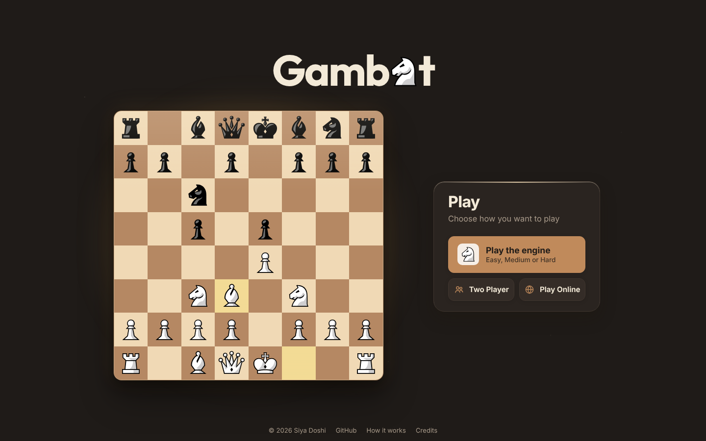

# Gambit

A chess engine written from scratch, playable in the browser.

**[Play it live →](https://chess-engine-1smz.onrender.com/)**


The engine searches with NegaMax and alpha-beta pruning, orders moves so it can skip most of the tree, remembers positions it has already searched in a transposition table, keeps calculating through captures with quiescence search, avoids repetition draws when it's winning, and deepens iteratively until its time runs out. It runs in a Web Worker, so the page stays smooth while it thinks. Hard plays at roughly 1,900 Elo on Stockfish's scale.

## Features

- **Play the engine** at Easy, Medium or Hard, as White or Black, with an evaluation bar and a live readout of what the engine found (score, depth, positions searched, time, best line)
- **Two Player** on one device, or **Play Online** with a share link or room code (Socket.IO, server-side move validation and clocks). Each player gets a private seat key, so a dropped connection or a refresh puts you back in your seat, and a game is private once both players have joined
- Name the players: click your name to change it; online, your friend sees it
- Drag-and-drop or click-to-move, promotion picker, captured pieces, hints, and a move list you can step back through (click a move or ← →) without changing the game
- Time controls from 1+0 to 10+0 with increments; the engine manages its own clock
- Board and piece themes, light and dark mode, sounds, and settings that are remembered
- Works on phones and laptops



## How the engine works

The engine lives in [`web/public/js/engine/`](web/public/js/engine):

| File | What it does |
| --- | --- |
| `board.js` | Fast move generation on top of chess.js's internal 0x88 board (~575k positions/sec) |
| `evaluate.js` | Material plus piece-square tables, with a separate king table for the endgame |
| `search.js` | NegaMax + alpha-beta, MVV-LVA move ordering, transposition table, quiescence search, repetition and 50-move draw detection, iterative deepening, time limit |
| `levels.js` | Easy / Medium / Hard settings |
| `worker.js`, `client.js` | Runs the search in a Web Worker and exposes `think(fen, level)` |

**Search.** NegaMax is minimax written once: my best score is the negative of my opponent's best score. Alpha-beta pruning stops looking at a move as soon as it's proven worse than an option already found.

**Move ordering.** Alpha-beta prunes the most when good moves come first, so captures are tried first, sorted by *most valuable victim, least valuable attacker*, and the best line from the previous depth is tried before anything else.

**Transposition table.** The same position is often reached by different move orders (1.e4 e5 2.Nf3 and 1.Nf3 e5 2.e4). Every searched position is stored under its 64-bit Zobrist hash with its depth, score, bound type and best move, so it can be reused instead of searched again; even when the stored search is too shallow, its best move is tried first. At depth 5 this cuts the search by 55%, and Hard reaches one more half-move in the same time.

**Draw awareness.** A position that already occurred (in the game or earlier in the searched line) and the 50-move limit score as draws, so the engine doesn't shuffle a won endgame into a threefold repetition, and a losing engine looks for one. These scores depend on how a position was reached, so they are kept out of the transposition table.

**Quiescence search.** At the end of the main search the engine keeps playing out captures until the position is quiet. Without this it would happily take a defended pawn with its queen because the recapture is one move past its horizon.

**Iterative deepening.** It searches depth 1, 2, 3, … and stops when its time budget runs out, keeping the last finished answer.

### Benchmarks

`npm run bench` searches standard positions with each technique switched on in turn (quiescence off so every row searches the same tree):

| Position | Depth | Minimax | + Alpha-beta | + Move ordering | + Transposition table |
| --- | --- | --- | --- | --- | --- |
| Start position | 4 | 216,369 · 5.1s | 2,152 · 0.06s | 2,128 · 0.05s | 2,004 · 0.04s (**99.1% fewer**) |
| Italian Game | 4 | 978,800 · 30.9s | 92,739 · 2.8s | 13,087 · 0.42s | 9,706 · 0.30s (**99.0% fewer**) |
| Kiwipete (middlegame) | 3 | 102,087 · 4.1s | 5,164 · 0.21s | 2,847 · 0.12s | 2,641 · 0.11s (**97.4% fewer**) |

The transposition table matters most in deeper searches: at depth 5 it cuts the Italian Game from 215,907 to 97,136 positions (55% fewer, 4.5s → 2.1s) and Kiwipete from 428,148 to 199,902 (53% fewer).

### Strength

Measured over **96 games per level** against **Stockfish 16.1** in its strength-limited mode, on the 60s + 0.6s clock its Elo setting is calibrated for. Each level played two Stockfish settings from 24 different openings, each opening once with each colour. The games run on GitHub Actions (the **Elo** workflow, 18 jobs side by side) and `bench/elo/summarize.mjs` turns them into a performance rating with a 95% range:

| Level | Search | Games (W / D / L) | Result | Elo (95% range) |
| --- | --- | --- | --- | --- |
| Easy | depth 3; 15% of the time picks one of its 3 best moves (never one that loses more than 1.5 pawns or misses a mate in one) | 96 (64 / 1 / 31) | 37/48 vs Stockfish 1320, 27.5/48 vs 1500 | **1,543** (1,468–1,628) |
| Medium | depth 4, capped at 1s | 96 (56 / 4 / 36) | 35.5/48 vs Stockfish 1600, 22.5/48 vs 1800 | **1,780** (1,706–1,859) |
| Hard | as deep as it can in 2.5s (usually 5–6 half-moves) | 96 (51 / 4 / 41) | 32/48 vs Stockfish 1800, 21/48 vs 2000 | **1,939** (1,865–2,016) |

These are on Stockfish's engine scale, not chess.com or FIDE ratings.

## Tests

```bash
cd web && npm test                          # engine and server tests (Node's built-in test runner)
python3 -m unittest discover desktop/tests  # desktop move generator, AI and promotion picker
```

- **Perft** checks count every position reachable in N moves and compare with the published numbers. Running them against the original Python move generator found three bugs: castling rights saved in the wrong order, castling still allowed after the rook was captured, and no under-promotion. All three are fixed, it now matches all six standard test positions, and the desktop game lets you choose the promotion piece (click or Q/R/B/N).
- Server tests start the real server and play through it: turn order, illegal moves, private games, players rejoining with their seat key, names, checkmate, clocks that wait for the first move, and malformed messages (one of which used to crash the server).
- Engine tests check mates in one and two, winning free material, the horizon effect, time limits, repetition and 50-move draws, driving a bare king to the edge, the bishop-and-knight mate (it finds mate from scattered starts well inside the 50-move limit), that Easy never gives away material for free or misses a mate in one, and that alpha-beta, move ordering and the transposition table return the same result as plain minimax while searching less.

## Run it locally

```bash
cd web
npm install
npm start          # http://localhost:3000
```

Or open the repo in **GitHub Codespaces**: the dev container installs everything and starts the app.

## Project structure

```
web/                 the web app (deployed)
  server.js          Express + Socket.IO: online games and clocks
  public/
    js/engine/       the chess engine
    js/app.js        game screen, clocks, modes
    js/board.js      board rendering, drag-and-drop, animations
  tests/             engine tests
  bench/             benchmark script
desktop/             the original Python + pygame version
  ChessEngine.py     board state and move generation
  ChessAI.py         NegaMax + alpha-beta for the desktop game
  tests/             perft and AI tests
```

The desktop version came first: it's where the move generator and the first NegaMax search were written. The web version uses the same ideas, with a faster search, more techniques and a full UI.

## Hosting note

The live demo runs on Render's free tier, which sleeps after a period without visitors, so the first load after a break can take up to a minute. A free uptime monitor (for example UptimeRobot pinging the site every 10 minutes) keeps it awake.

## Credits

- Chess pieces: [Kosal](https://github.com/philatype/kosal) by philatype, [CC BY 4.0](https://creativecommons.org/licenses/by/4.0/). The Gambit logo's pawn and knight are cropped from this set. Original "Classic" pieces are also available in settings.
- Fonts: [Inter](https://github.com/rsms/inter) and [Outfit](https://github.com/Outfitio/Outfit-Fonts), SIL Open Font License 1.1 (see `web/public/fonts`).
- Rules and move legality: [chess.js](https://github.com/jhlywa/chess.js). Piece-square tables: Tomasz Michniewski's Simplified Evaluation Function.

## License

MIT for the code, see [LICENSE](LICENSE). Pieces and fonts keep their own licenses listed above.
